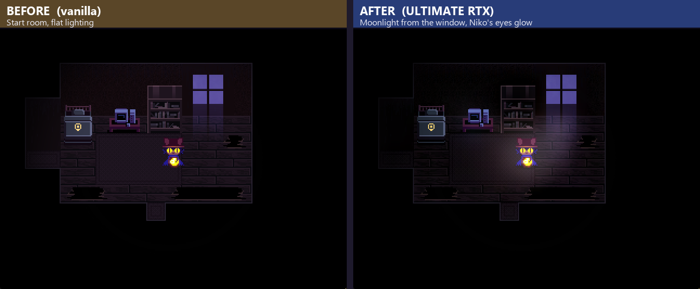
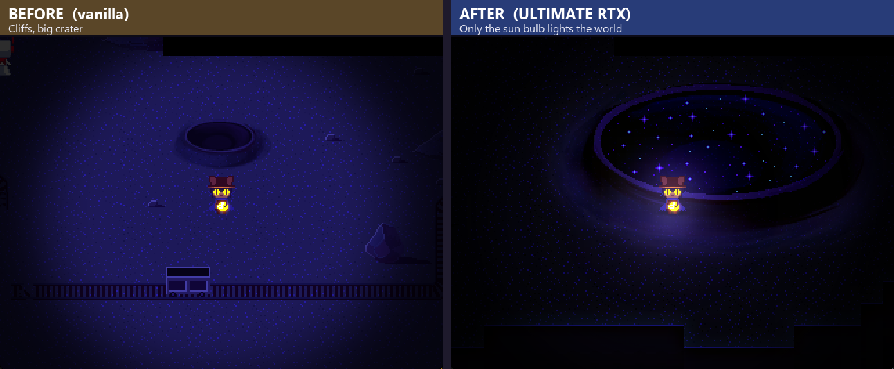
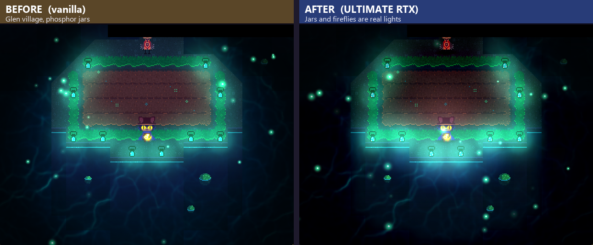
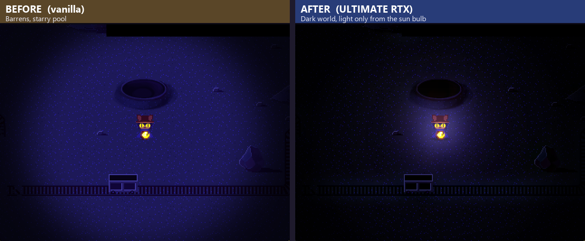
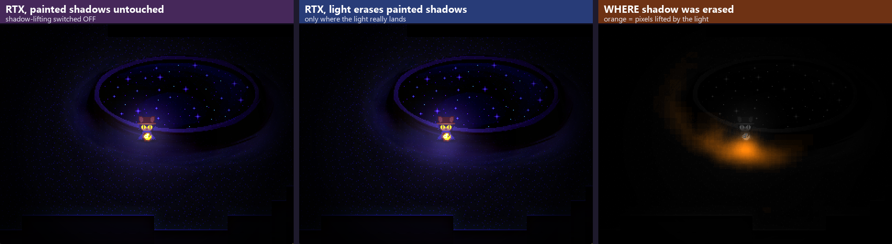
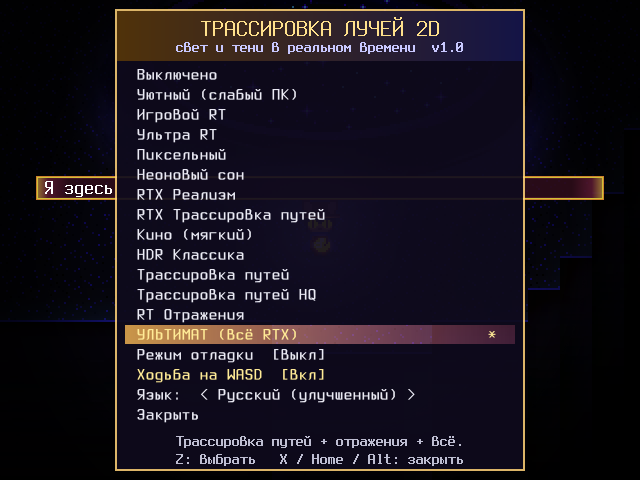
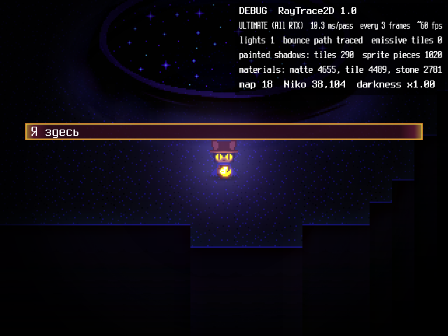

# OneShot RTX

Real-time ray traced lighting for **OneShot** (the 2016 PC game).

Lights cast real shadows, light bounces off walls, glowing things actually glow, and the
painted shadows in the artwork fade away where your light reaches them. It all runs inside the
game itself, so there's no extra program, nothing in the background, and it stops when the game closes.

> These are untouched in-game screenshots. Left is the vanilla game, right is the mod.
> Same spot, same moment, only cropped and labeled.

### Light erases the painted shadows, only where it lands

OneShot's artists painted shadows into the art (around craters, pools, walls). With the mod,
those painted shadows get lifted piece by piece by the light that actually reaches them.
The orange heat map on the right shows exactly which pixels the light un-shadowed.

---

## What it does

- **Ray traced shadows.** Every light shoots shadow rays through the map. Shadows are sharp near the
  object and get softer with distance, depending on how big the light is (the sun bulb is small, a window is big).
- **Path traced bounce light.** Light bounces off walls and picks up their color.
- **Every light in the game is a real light.** Niko's sun bulb, Niko's eyes, windows, lamps, phosphor jars,
  screens and TVs, clovers, fishtanks, portal rays, fireflies... I scanned all 263 maps for them.
- **Glowing tiles light the room.** Neon tubes, lit windows and monitors baked into the tilesets become area lights.
- **Materials.** Floors are read from the game's own footstep sounds (wood, tile, metal, water...),
  walls from their pixels. Water and metal get faint reflections, the way they really look from above.
- **Painted shadows react to light** (see above).
- **Characters cast shadows** from every light that can see them, plus soft contact shadows under their feet.
- **A darker world.** Places without light are properly dark, and your light is what reveals things.
- **Small stuff:** slight flame flicker, light shafts in the air, filmic tone mapping, no flicker or noise.

It never touches the game's UI. Menus, the inventory, computer screens, messages and puzzles all look exactly as before.

## Requirements

- OneShot for PC (the original 2016 game, Steam or DRM-free). *Not* the World Machine Edition.
- Windows 10 or 11. Nothing else to install: the installer uses Windows PowerShell, which every Windows PC has.

## Install (about 1 minute)

1. **Download** this repo: green **Code** button → **Download ZIP**, then extract it anywhere (Desktop is fine).
2. **Close OneShot** if it's running.
3. **Double-click `install.bat`.**
   - It looks for OneShot by itself (Steam libraries included).
   - If it can't find it, a window pops up: pick the folder that contains `oneshot.exe`.
     On Steam that's usually `C:\Program Files (x86)\Steam\steamapps\common\OneShot`.
4. Wait for **"Done!"**, press a key to close the window.
5. Start OneShot like you always do. That's it.

If Windows shows a blue "Windows protected your PC" box for `install.bat`, click **More info → Run anyway**.
That happens with any downloaded script.

### What the installer changes

- copies the mod into `OneShot\Mods\`
- makes a one-time backup: `Data\xScripts.rxdata.rt2d-backup`
- adds one tiny script ("RayTrace2D Loader") right before the game's `Main` script, and checks the result before saving

Running it again is safe. It just updates the mod. Your saves are never touched.

## Controls

| Key | What it does |
| --- | --- |
| **Home**, **F8** or a quick tap of **Alt** | open / close the RTX menu (while walking around) |
| Arrows or **W A S D** | move (in the game and in the menu) |
| **Z** | choose |
| **X** | close the menu |

Alt only opens the menu if you tap it on its own, so Alt+Enter (fullscreen) and Alt+Tab still work normally.

### WASD

The mod lets you walk with W A S D. Because OneShot already used some of those letters, three actions moved:

| Old key | Action | New key |
| --- | --- | --- |
| A | main menu | **Q** |
| S | inventory | **E** |
| W | hold to skip text | **R** |

You can turn WASD off in the RTX menu.

## The RTX menu

**Presets**, from lightest to heaviest:

| Preset | |
| --- | --- |
| Off | vanilla lighting |
| Cozy (Low) | for weak PCs |
| Game Style RT / Ultra RT | ray traced shadows, soft |
| Pixel Raw | no blur, crunchy retro shadows |
| Neon Dream | rainbow lights, just for fun |
| RTX Realistic / RTX Path Traced | bounce light, emissives, reflections |
| Cinematic Soft | low contrast, easy on the eyes |
| HDR Classic | 2004-style bloom and eye adaptation |
| Path Tracing / Path Tracing HQ | real Monte Carlo bounce light |
| RT Reflections | water and metal reflections |
| **ULTIMATE (All RTX)** | everything at once (default) |

**Debug mode** shows live info in the corner: how long a lighting pass takes, how many
lights are active, how many painted shadows and materials it found on the map, and where you are.
Handy if something looks off.

**Language** switches between English (original), Russian (official) and Russian (improved).
The improved Russian is a fan rewrite that's more natural and emotional. It's still a work in progress:
lines that aren't rewritten yet use the official translation. It gets built on your PC from your own
game files the first time you start the game, so no game text is included in this repo.

## Performance

A lighting pass takes about 8 to 16 ms and runs every few frames, so the game stays at its normal speed.
If your PC is slower, the mod notices and updates the light a bit less often by itself.
Still too slow? Pick **Cozy (Low)** or **Game Style RT**.

## Uninstall

Close the game and double-click **`uninstall.bat`**. It removes the loader from the game scripts and deletes
the mod files. Your saves and settings stay.

## Troubleshooting

- **No RTX in game.** Check you installed into the copy you actually play. If you have two OneShot folders, run the
  installer for each one. Then look at `OneShot\Mods\RayTrace2D.log`. The first line of each session says
  `RayTrace2D 1.0 loaded`.
- **The game itself won't start (blocked by Windows).** Some PCs with Smart App Control or company policies
  block programs in new folders. That's Windows blocking `oneshot.exe`, not the mod. Run the game from the
  folder it was installed in.
- **"Could not find OneShot".** Pick the folder with `oneshot.exe` in the window that pops up, or run
  `install.bat "D:\Games\OneShot"` with your path.
- **Something looks wrong.** Turn on Debug mode, take a screenshot and open an issue. The log file helps a lot too.
- **The mod hit an error.** It switches itself off for that session instead of crashing, and writes the reason into the log.

## How it works (short version)

OneShot runs on mkxp, an RPG Maker XP engine. The engine has no shader access from scripts, so everything here
is done in Ruby on a light grid. For every light it traces shadow rays against the map's solid tiles and
characters, adds path-traced bounce light, and then draws two layers over the map: one that darkens and one that
adds light. The darkening uses the real ground color under each spot, so it behaves like proper multiply
lighting even though the engine only supports add and subtract blending. Painted shadows are found by scanning
the game's own images for dark, see-through pixels.

## Credits

- **OneShot** by Future Cat LLC (Eliza Velasquez, Michael Shirt, Nightmargin and team). This mod is fan-made and not affiliated
  with them. No game files are included here, so you need your own copy of OneShot.
- Mod made with the help of **Claude** (Anthropic), who co-wrote the code.

## License

The mod code is MIT licensed (see `LICENSE`). OneShot itself and its art belong to its creators.
